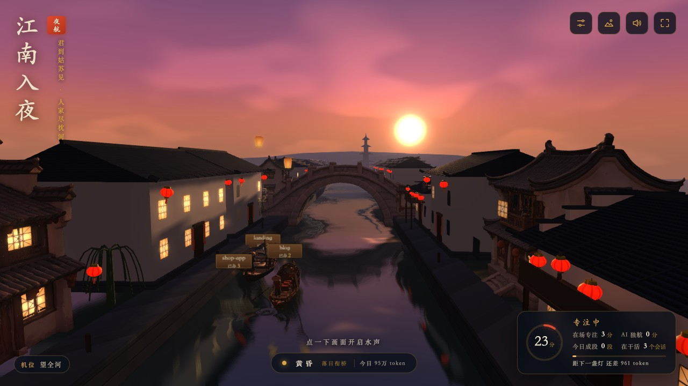
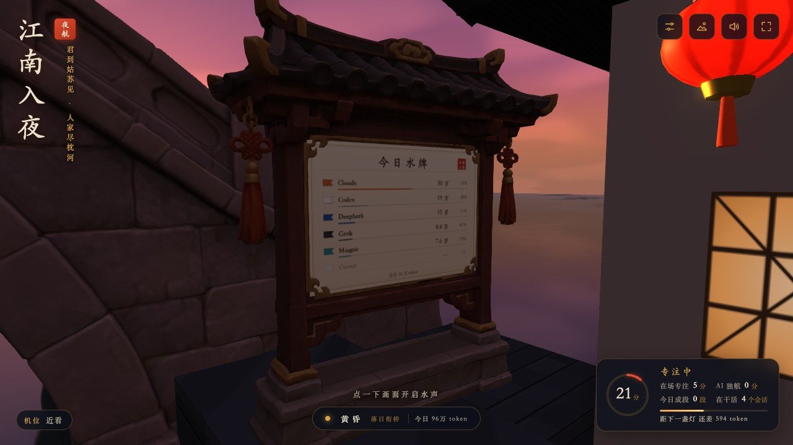
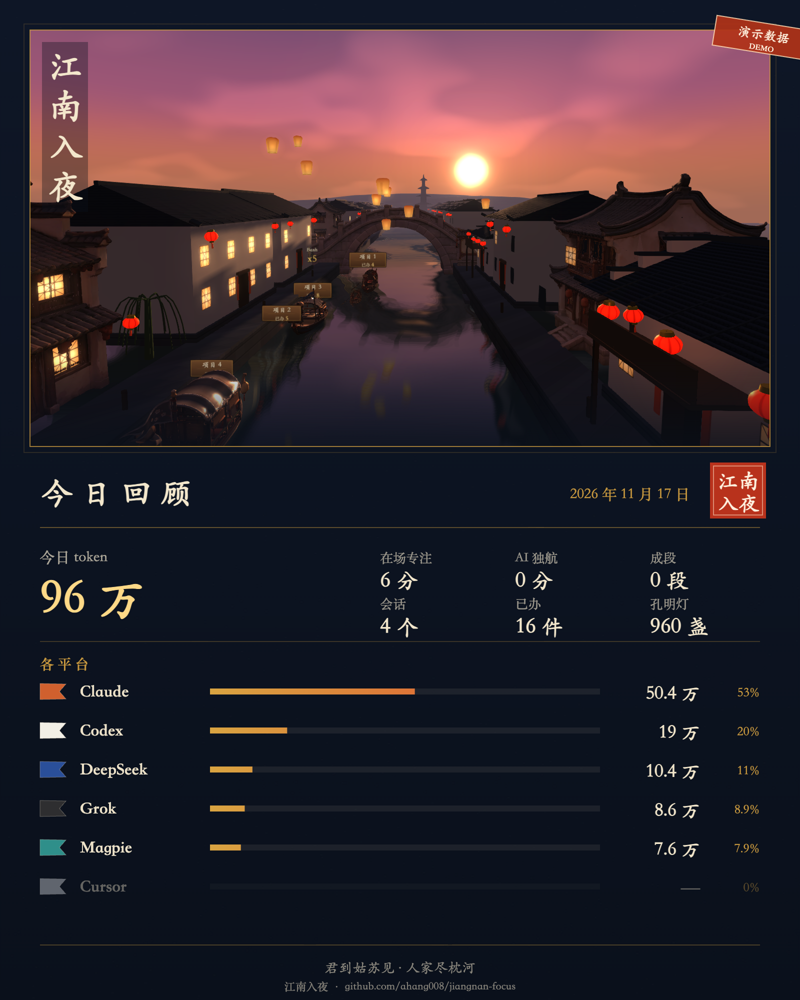

# Jiangnan at Night · Focus Voyage

A small Jiangnan water-town webpage to keep on a second monitor. While your AI coding tools (Claude Code, Codex, etc.) are working, the water town comes alive: each session is a boat, each tool call rows the oar, tokens become rising sky lanterns, and the bridge-side board shows today's usage per platform.


[中文版](README.md)







[Watch the full 30-second demo video](docs/jiangnan-focus-demo-1080p.mp4)

## What you get

- Each boat on the river is one AI session; its sign shows the project name and "done N" tool calls.
- A tool call rows the oar and flashes the lamp; a file change lights a window on the shore.
- The sky moves slowly from afternoon to dusk — it never turns to night. More tokens today mean more rising sky lanterns and brighter lanterns along the river.
- Every 1000 tokens launches a sky lantern (or taps a wooden fish, or both).
- Every 1,000,000 tokens shows a big lantern and a message with a chime (or a bowl bell in wooden-fish mode).
- The bridge-side board shows today's usage and share for six platforms.
- The focus ring shows "focus with you / AI solo / segments today".
- You can generate a daily recap card image in settings.
- Add `?demo=1` for a demo mode with eight simulated boats.

## Supported platforms

| Platform | Readable? |
|---|---|
| Claude Code | Yes |
| Codex | Yes |
| DeepSeek Harness | Yes |
| Grok Build | Yes |
| Magpie | Yes |
| Cursor CLI (via Magpie) | Yes |
| Cursor app | Not yet: usage isn't stored locally, so it can't be read on this machine |

Windows and Linux: it runs; keyboard/mouse presence detection depends on the OS (most accurate on macOS).

## Quick start

Requires Node 22 or newer. Check first:

```bash
node --version
```

```bash
git clone https://github.com/ahang008/jiangnan-focus
cd jiangnan-focus
node start.mjs
```

Then open http://127.0.0.1:4317/ . Use `node start.mjs --no-open` to skip opening the browser.

Want a quick look before using any AI tool? Open the demo page: http://127.0.0.1:4317/?demo=1

### Stop / status / uninstall

- Stop: `node start.mjs --stop`
- Check whether it is running and today's usage: `node start.mjs --status`
- Uninstall: stop it, delete the data directory `~/.jiangnan-focus` (on Windows `%USERPROFILE%\.jiangnan-focus`; if you set `JN_HOME`, delete that instead), then delete the whole repository folder.

### Port and source configuration

Change the port: `JN_PORT=4318 node start.mjs --no-open` (Windows PowerShell: `$env:JN_PORT=4318; node start.mjs --no-open`). To disable a source, change log directories, or learn about Linux idle detection, see [server/README.md](server/README.md).

## Privacy

- It reads those AI tools' local record files to count usage, but never saves, shows, or uploads conversation text.
- Only timestamps, session ids, token counts, tool names, and project folder names are extracted; conversation text, code, command arguments, and keys are never extracted, saved, shown, or uploaded.
- Read-only: it never writes, moves, or changes their config.
- Nothing is uploaded; it does not use the network.
- It listens only on 127.0.0.1, so other machines cannot reach it.
- The boat signs and the daily recap card contain project folder names; before downloading and sharing, enable "hide project names" in settings and check the image.

## Settings

Open "Settings" (top-right):

- Feedback: every 1000 tokens -> sky lantern / wooden fish / both; the unit can be 500, 2000, or 5000.
- Volume: drag to adjust, or mute.
- Rules: session active window, segment length, allowed gap, session end; plus "only count focus when I'm here".
- Reset focus: clears today's focus-with-you, AI-solo, segments, and the current segment; today's tokens, owned rewards, and pending rewards are left untouched.
- Recap card: generate and download today's recap image.
- Quality: in "Scene", choose ultra / high / balanced / low.

## FAQ

**No numbers on the page?** Check the "detected sources" the program prints when it starts. On startup it prints how many files it read, how many sessions, and today's token count; a zero means that source had nothing today. Also check whether the page shows "local server not running". To confirm the page itself works, open http://127.0.0.1:4317/?demo=1 .

**"Today's logs are unavailable"?** The bottom-right corner of the page shows a non-blocking notice (with the affected sources) when a source's logs for today are temporarily unreadable (missing files, unreadable directory, etc.) and the board is using the last saved snapshot. Refresh after the logs are back; see [server/README.md](server/README.md).

**Settings don't apply?** Settings are sent to the local server; make sure the server is running (the terminal shows `http://127.0.0.1:4317/`).

## Assets and licensing

The code is released under the MIT License (see LICENSE); the 3D models and concept art are released under the Jiangnan Focus Asset License (see ASSETS-LICENSE). The two licenses are separate and do not conflict: code and assets are different works, each under its own license.

The asset license lets anyone use, modify, and redistribute these 3D models and concept art for free, including commercial use, as long as they credit "Jiangnan Focus contributors" and do not use the assets to train AI models or build a 3D generation service. The 3D models were generated by the project author using a paid Tripo AI plan with the models set to private; under the Tripo Terms of Service (https://www.tripo3d.ai/terms, verified 2026-11-17), the model rights belong to the generating account holder, so they can be redistributed here under the asset license above. ASSETS-LICENSE includes a per-file inventory of each glb file's generation method and date.

## Thanks

- three.js (MIT), see THIRD_PARTY_NOTICES
- The scene was originally generated by Tongyi Qianwen
- 3D models by Tripo AI

## License

- Code: MIT, see LICENSE
- Assets: Jiangnan Focus Asset License, see ASSETS-LICENSE
- Third-party: see THIRD_PARTY_NOTICES
