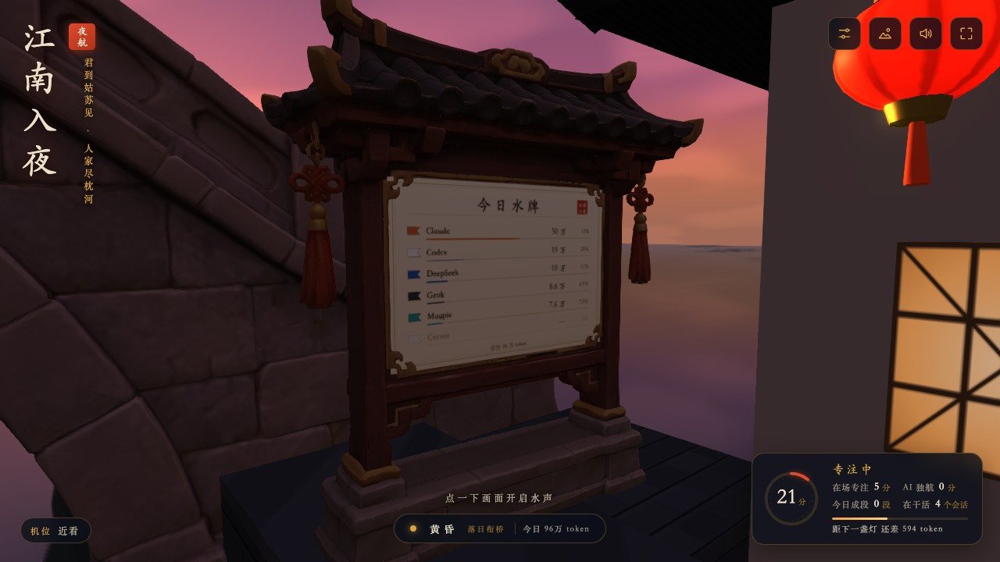
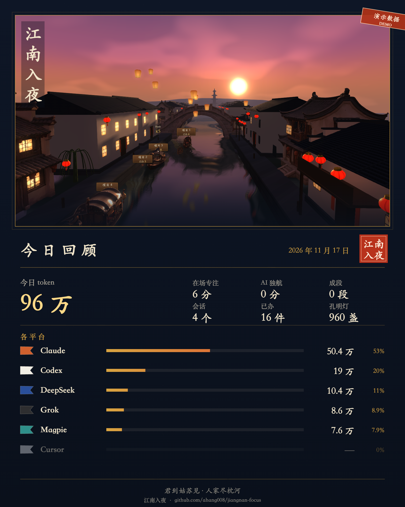

# 江南入夜 · 专注夜航

一个挂在副屏上的江南水乡小网页。你的 AI 编程工具（Claude Code、Codex 等）在干活，水乡就跟着动：每个会话是一条船，工具调用就摇一下桨，用掉的 token 变成一盏盏升空的孔明灯，桥头水牌显示六个平台今天的用量。


[English version](README.en.md)






[观看 30 秒完整演示视频](docs/jiangnan-focus-demo-1080p.mp4)

## 能玩到什么

- 河上每条船对应一个 AI 会话，船头木牌写着项目名和「已办几件事」。
- 工具调用一次，船就摇一下桨、灯闪一下；改一个文件，岸边一扇窗就亮起来。
- 天色从午后缓缓到黄昏，不会真正入夜：今天 token 越多，升空的孔明灯越多、沿岸的灯笼越亮。
- 每满 1000 token 放一盏孔明灯升空（也可以改成敲木鱼，或者两样都要）。
- 每满 100 万 token，会有一盏大灯和一行大字，配一声风铃（木鱼模式是一声磬）。
- 桥头水牌列出六个平台今天的用量和占比。
- 右下角专注进度环显示「在场专注 / AI 独航 / 今日成段」。
- 设置里能生成一张「今日回顾卡」图片。
- 网址加 `?demo=1` 可以开演示模式，不看真实记录，模拟八条船来回跑。

## 支持哪些平台

| 平台 | 能不能读 |
|---|---|
| Claude Code | 能 |
| Codex | 能 |
| DeepSeek Harness | 能 |
| Grok Build | 能 |
| Magpie | 能 |
| Cursor CLI（经 Magpie） | 能 |
| Cursor 主程序 | 暂不支持：用量不落本地，程序在本机读不到 |

Windows 和 Linux：能运行；键鼠在场检测视系统而定（macOS 上最准）。

## 一条命令跑起来

需要 Node 22 或更高版本。先确认版本：

```bash
node --version
```

```bash
git clone https://github.com/ahang008/jiangnan-focus
cd jiangnan-focus
node start.mjs
```

然后浏览器打开 http://127.0.0.1:4317/ 。不想自动开浏览器就 `node start.mjs --no-open`。

还没开始用 AI 工具、想先看效果？直接打开演示页：http://127.0.0.1:4317/?demo=1

### 停止 / 状态 / 卸载

- 停止：`node start.mjs --stop`
- 查看是否在运行和今天的用量：`node start.mjs --status`
- 卸载：先停止，再删除存档目录 `~/.jiangnan-focus`（Windows 为 `%USERPROFILE%\.jiangnan-focus`；若用 `JN_HOME` 指定过就删那个目录），最后删掉整个仓库文件夹。

### 端口和来源配置

换端口：`JN_PORT=4318 node start.mjs --no-open`（Windows PowerShell 用 `$env:JN_PORT=4318; node start.mjs --no-open`）。停用某个来源、改日志目录、Linux 空闲检测等更多配置见 [server/README.md](server/README.md)。

## 隐私

- 会读取本机这几个 AI 工具的记录文件来计数，但不保存、不显示、不上传对话正文。
- 只提取时间、会话、token 数、工具名和项目文件夹名；不提取、保存、展示或上传正文、代码、命令参数、密钥。
- 只读不改：不写入、不移动、不改它们的配置。
- 不上传任何数据，不联网。
- 只监听 127.0.0.1，别的机器访问不到。
- 船头木牌和「今日回顾卡」里会显示项目文件夹名；下载分享前请先在设置里打开「隐藏项目名」并检查图片内容。

## 设置说明

点右上角「设置」按钮：

- 反馈：每 1000 token 放孔明灯 / 敲木鱼 / 两样都要；单位可改成 500、2000、5000。
- 音量：拖动调节，也能静音。
- 规则：会话干活的判定、一段专注多长、允许停顿多久、会话多久结束；还能开「只算我在场的专注」。
- 专注归零：把今天的在场专注、AI 独航、成段和当前段清零；今天的 token、收藏和待领奖励都不受影响。
- 回顾卡：生成今天的竖版回顾图，可下载。
- 画质：在「造境」里，有超清 / 高 / 均衡 / 低可选。

## 常见问题

**打开页面没有数字怎么办？** 看启动时终端打印的「检测到的来源」。程序一启动就会打印读到了多少个文件、多少个会话、今天多少 token；哪一项是 0，就是那个来源今天还没读到记录。也可以看页面右下角有没有「本地小程序没开」。想先确认页面本身没问题，可以打开 http://127.0.0.1:4317/?demo=1 看演示。

**看到「今天的日志当前不可用」怎么办？** 页面右下角会显示一条非阻断提示，并标出受影响来源；这说明某个来源今天的日志暂时读不到（文件缺失、目录不可读等），页面上的水牌来自上次保存的快照。等日志恢复后刷新页面即可；详细说明见 [server/README.md](server/README.md)。

**改了设置没生效？** 设置是发给本地小程序保存的，先确认小程序在跑（终端里能看到 `http://127.0.0.1:4317/`）。

## 素材说明与授权

代码以 MIT 许可发布，见 LICENSE；3D 模型和概念图以「Jiangnan Focus 素材许可」发布，见 ASSETS-LICENSE。两套授权分开且互不冲突：代码和素材是两类不同的作品，分别适用各自的许可。

素材许可允许任何人免费使用、修改和再分发这些 3D 模型与概念图（含商用），但必须署名 "Jiangnan Focus contributors"，并且不得用这些素材训练 AI 模型或搭建 3D 生成服务。3D 模型由项目作者用 Tripo AI 付费套餐生成并设为私有；依据 Tripo 服务条款（https://www.tripo3d.ai/terms，核实日期 2026-11-17），模型权利归生成账号持有人，因此可在此按上述素材许可再分发。ASSETS-LICENSE 里附有每个 glb 文件的生成方式和日期清单。

## 致谢

- three.js（MIT 协议），详见 THIRD_PARTY_NOTICES
- 场景最初由通义千问生成
- 3D 模型由 Tripo AI 生成

## 许可

- 代码：MIT，见 LICENSE
- 素材：Jiangnan Focus 素材许可，见 ASSETS-LICENSE
- 第三方：见 THIRD_PARTY_NOTICES
